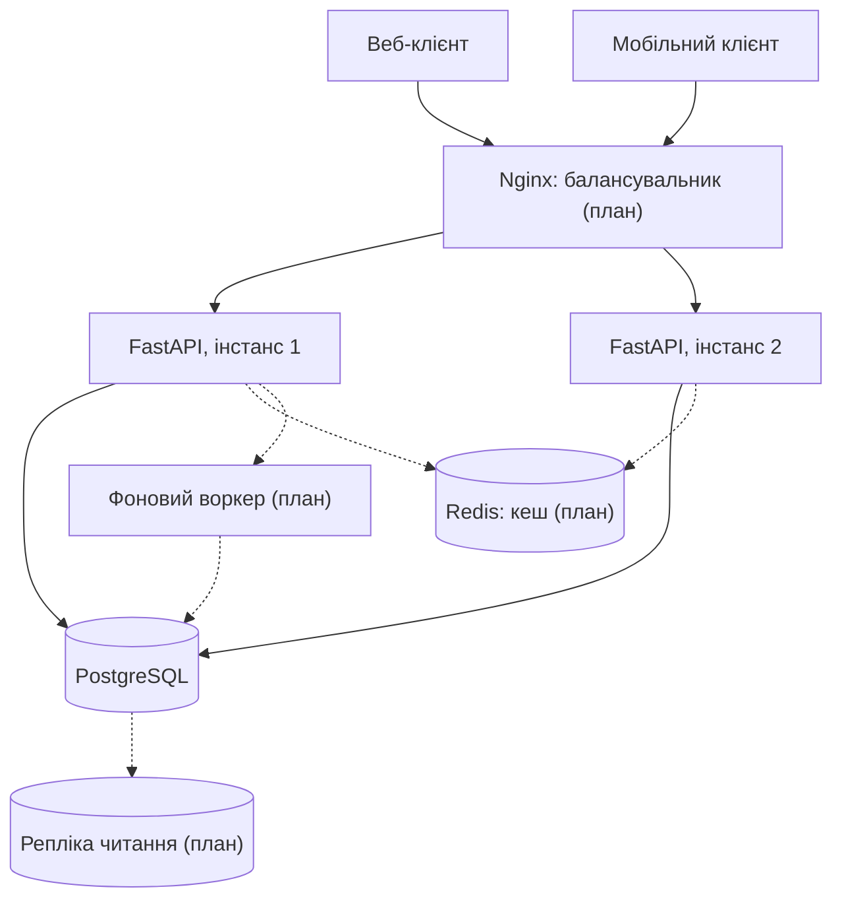
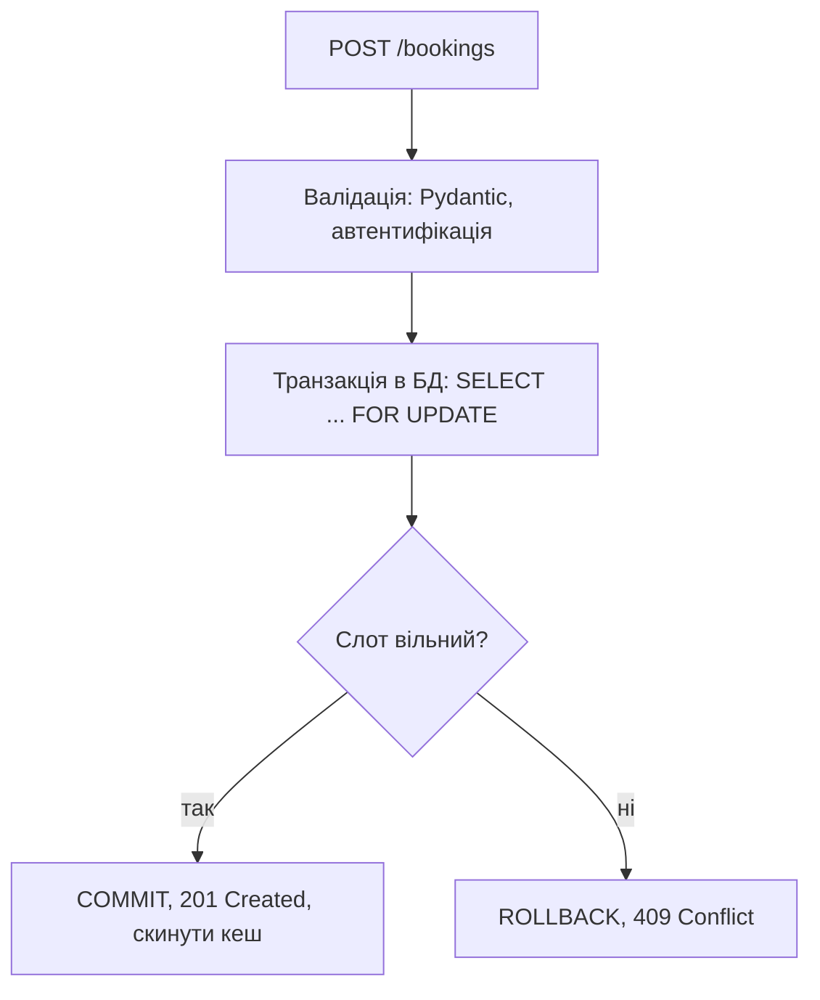
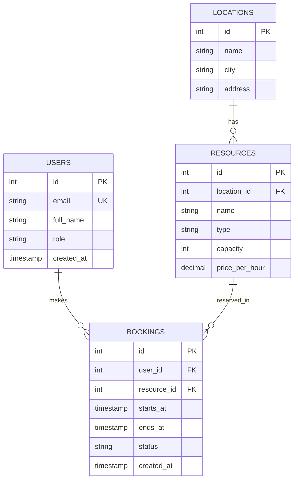

# Архітектура системи

Платформа бронювання коворкінгів та конференц-залів. Компоненти з позначкою «план» буде додано в наступних лабораторних.

## 1. Загальна архітектура

Бекенд не зберігає стан, тому інстанси FastAPI можна масштабувати горизонтально. Усі дані лежать у PostgreSQL, Redis зменшує навантаження на читання, а воркер виконує повільні задачі (листи, звіти, очищення прострочених бронювань).

## 2. Обробка запиту на бронювання

Блокування рядка ресурсу гарантує, що два одночасні запити на той самий слот не пройдуть обидва: другий отримає `409 Conflict`.

## 3. Модель бази даних

Таблиця `BOOKINGS` є центральною й найбільш навантаженою, тому саме на неї орієнтуватимуться індексування та кешування.
