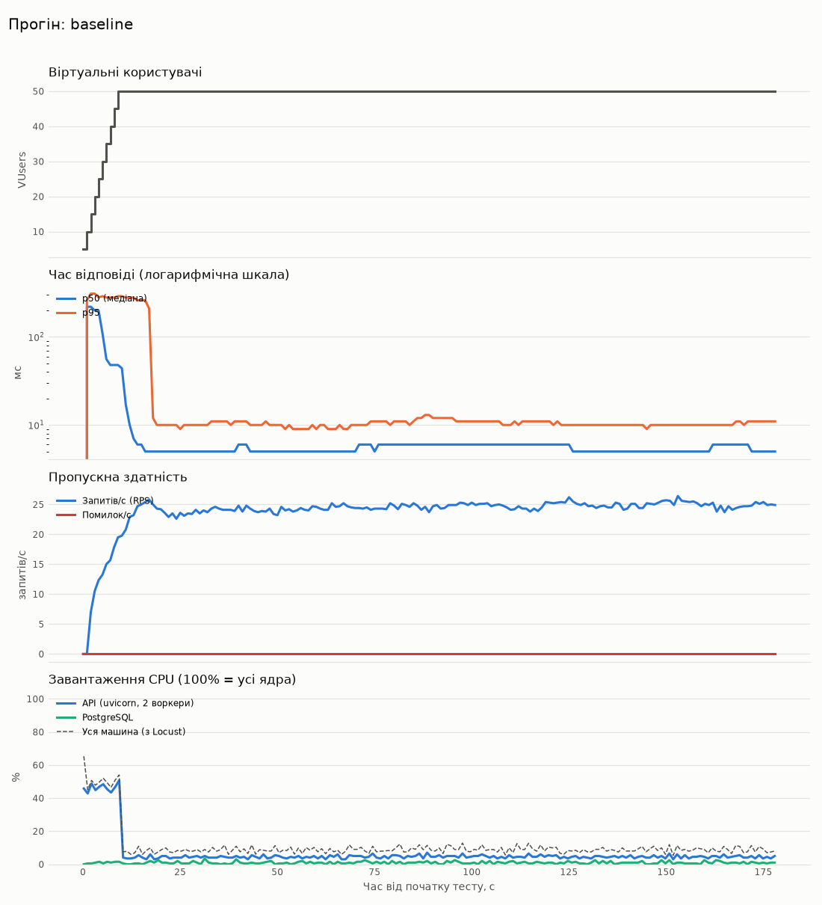
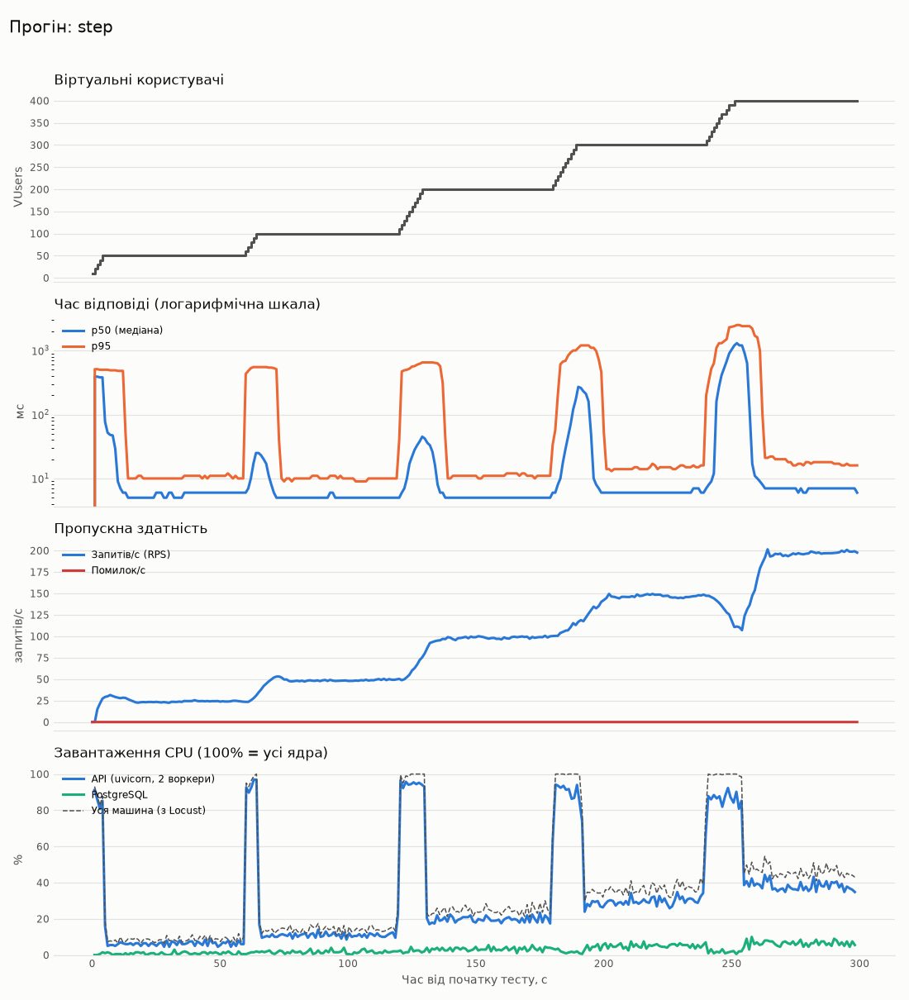
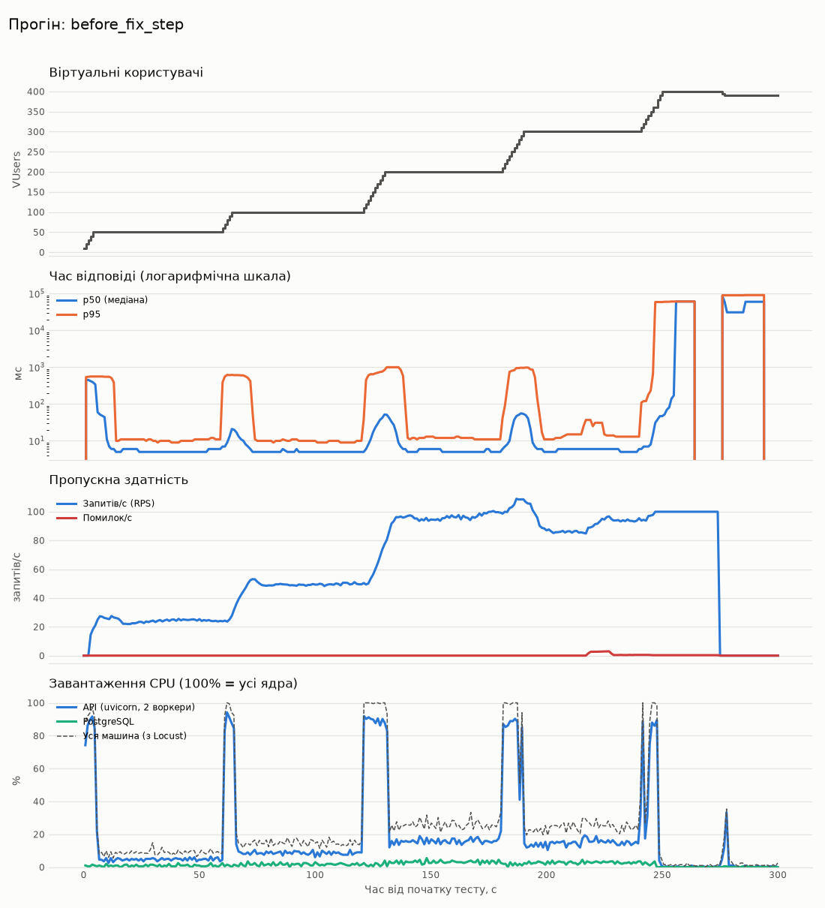

# Лабораторна №4: первинне навантажувальне тестування

## 1. Планування

**Інструмент: Locust 2.47** — сценарії пишуться на Python (та сама мова, що
й у проєкті), є headless-режим із CSV-звітами для автоматизації та
`LoadTestShape` для ступінчастого навантаження.

**Цільові ендпоінти MVP** (ваги відповідають частоті дій реального клієнта):

| Ендпоінт | Дія | Вага |
|---|---|---:|
| `POST /auth/register`, `POST /auth/login` | реєстрація та вхід (раз на користувача) | on_start |
| `GET /resources` | перегляд кімнат/місць | 5 |
| `GET /locations` | перегляд локацій | 3 |
| `GET /bookings/my` | мої бронювання | 3 |
| `GET /users/me` | профіль | 2 |
| `POST /bookings` | бронювання випадкового слоту | 2 |
| `POST /bookings/{id}/cancel` | скасування свого бронювання | 1 |

Пауза між діями користувача — 1–3 с. Відповідь `409` (слот зайнятий)
вважається коректною бізнес-відповіддю, а не помилкою.

**Профілі навантаження:**

| Прогін | VUsers | Ramp-Up | Тривалість |
|---|---|---|---|
| Контрольний (`baseline`) | 50 | 10 с (5 користувачів/с) | 3 хв |
| Ступінчастий (`step`) | 50 → 100 → 200 → 300 → 400 | 10 користувачів/с, крок щохвилини | 5 хв |

**Тестове середовище:** sandbox, 2 vCPU, 8 ГБ RAM, PostgreSQL 16, uvicorn з
2 воркерами (та сама команда, що в Docker-образі, `WEB_CONCURRENCY=2`).
Locust працював на тій самій машині, тому частина CPU (пунктир на
графіках) — це сам генератор навантаження. Дані підготовлено командою
`python -m loadtests.seed` (1 локація, 20 ресурсів).

## 2. Сценарій і запуск

- `loadtests/locustfile.py` — поведінка користувача;
- `loadtests/shape_step.py` — ступінчастий профіль;
- `loadtests/monitor.py` — збір CPU/RAM процесів API та PostgreSQL щосекунди;
- `loadtests/report.py` — таблиці й графіки з CSV;
- сирі результати — `loadtests/results/raw/`.

```bash
pip install -r loadtests/requirements.txt
python -m loadtests.seed
python loadtests/monitor.py --out loadtests/results/raw/baseline_resources.csv &
locust -f loadtests/locustfile.py --host http://localhost:8000 --headless \
  -u 50 -r 5 -t 3m --csv loadtests/results/raw/baseline --csv-full-history
python loadtests/report.py baseline step
```

## 3. Метрики

### 3.1 Контрольний прогін: 50 VUsers, 3 хв

| Ендпоінт | Запитів | Помилок | RPS | Avg, мс | Min, мс | Max, мс | p50, мс | p95, мс | p99, мс |
|---|---:|---:|---:|---:|---:|---:|---:|---:|---:|
| `GET /bookings/my` | 862 | 0 (0.00%) | 4.8 | 6 | 3 | 64 | 5 | 9 | 48 |
| `GET /locations` | 828 | 0 (0.00%) | 4.6 | 6 | 3 | 60 | 5 | 9 | 48 |
| `GET /resources` | 1373 | 0 (0.00%) | 7.7 | 6 | 3 | 60 | 5 | 9 | 17 |
| `GET /users/me` | 537 | 0 (0.00%) | 3.0 | 5 | 3 | 48 | 4 | 7 | 11 |
| `POST /auth/login` | 50 | 0 (0.00%) | 0.3 | 244 | 152 | 320 | 250 | 300 | 320 |
| `POST /auth/register` | 50 | 0 (0.00%) | 0.3 | 244 | 109 | 315 | 260 | 310 | 320 |
| `POST /bookings` | 482 | 0 (0.00%) | 2.7 | 10 | 5 | 31 | 10 | 14 | 20 |
| `POST /bookings/{id}/cancel` | 196 | 0 (0.00%) | 1.1 | 9 | 6 | 30 | 8 | 13 | 23 |
| **Усього** | 4378 | 0 (0.00%) | 24.4 | 12 | 3 | 320 | 6 | 13 | 260 |

Ресурси сервера:

| Показник | Середнє | Максимум |
|---|---:|---:|
| CPU машини, % | 11.1 | 65.3 |
| CPU API (uvicorn), % | 6.9 | 50.8 |
| CPU PostgreSQL, % | 0.9 | 3.5 |
| RAM API, МБ | 218.9 | 219.1 |
| RAM PostgreSQL, МБ | 601.2 | 607.3 |
| RAM машини (зайнято), МБ | 845.1 | 845.4 |



При 50 користувачах система працює з великим запасом: 0 помилок, p95 13 мс,
CPU API в середньому 7%. Виділяються лише `register/login` (~250 мс).

### 3.2 Ступінчастий прогін до 400 VUsers (після виправлення)

| Ендпоінт | Запитів | Помилок | RPS | Avg, мс | Min, мс | Max, мс | p50, мс | p95, мс | p99, мс |
|---|---:|---:|---:|---:|---:|---:|---:|---:|---:|
| `GET /bookings/my` | 5536 | 0 (0.00%) | 18.4 | 63 | 3 | 2490 | 6 | 370 | 1300 |
| `GET /locations` | 5524 | 0 (0.00%) | 18.4 | 66 | 3 | 2496 | 6 | 430 | 1400 |
| `GET /resources` | 9318 | 1 (0.01%) | 31.0 | 71 | 3 | 2531 | 6 | 480 | 1500 |
| `GET /users/me` | 3626 | 0 (0.00%) | 12.1 | 72 | 2 | 2533 | 5 | 480 | 1500 |
| `POST /auth/login` | 400 | 0 (0.00%) | 1.3 | 976 | 248 | 3668 | 650 | 2500 | 3600 |
| `POST /auth/register` | 400 | 0 (0.00%) | 1.3 | 1030 | 123 | 3623 | 680 | 2500 | 3600 |
| `POST /bookings` | 3421 | 0 (0.00%) | 11.4 | 66 | 4 | 2486 | 11 | 370 | 1300 |
| `POST /bookings/{id}/cancel` | 1395 | 0 (0.00%) | 4.6 | 60 | 5 | 2473 | 9 | 310 | 1200 |
| **Усього** | 29620 | 1 (0.00%) | 98.6 | 93 | 2 | 3668 | 7 | 620 | 1700 |

Ресурси сервера:

| Показник | Середнє | Максимум |
|---|---:|---:|
| CPU машини, % | 35.7 | 100.0 |
| CPU API (uvicorn), % | 30.5 | 97.0 |
| CPU PostgreSQL, % | 3.1 | 10.0 |
| RAM API, МБ | 298.3 | 319.1 |
| RAM PostgreSQL, МБ | 591.8 | 1338.9 |
| RAM машини (зайнято), МБ | 848.9 | 925.6 |



### 3.3 Підсумкова таблиця

| Показник | 50 VUsers (baseline) | 400 VUsers (пік step) |
|---|---:|---:|
| RPS | 24.4 | ~198 |
| Latency avg / min / max, мс | 12 / 3 / 320 | 93 / 2 / 3668 (за весь прогін) |
| Latency p50 / p95 (усталений режим), мс | 6 / 13 | 7 / 17–18 |
| Error Rate | 0% | 0.003% (1 з 29 620) |
| CPU API, середнє / макс. | 7% / 51% | 31% / 97% |
| CPU PostgreSQL, макс. | 3.5% | 10% |
| RAM API (2 воркери) | 219 МБ | 319 МБ |

У CSV CPU процесу наведено у відсотках від усієї машини (100% = обидва
ядра). RAM PostgreSQL — сума RSS процесів, куди повторно входить спільна
пам'ять (shared buffers), тому це оцінка зверху.

## 4. Виявлені вузькі місця

### 4.1 Взаємне блокування пулу з'єднань (критичне, виправлено)

Перший ступінчастий прогін (до виправлення):

| Ендпоінт | Запитів | Помилок | RPS | Avg, мс | Min, мс | Max, мс | p50, мс | p95, мс | p99, мс |
|---|---:|---:|---:|---:|---:|---:|---:|---:|---:|
| `GET /bookings/my` | 3038 | 20 (0.66%) | 10.9 | 362 | 2 | 89346 | 5 | 68 | 450 |
| `GET /locations` | 3064 | 20 (0.65%) | 11.0 | 418 | 2 | 88894 | 5 | 66 | 630 |
| `GET /resources` | 5111 | 42 (0.82%) | 18.4 | 463 | 2 | 89746 | 6 | 69 | 660 |
| `GET /users/me` | 1976 | 17 (0.86%) | 7.1 | 542 | 2 | 89838 | 4 | 73 | 30000 |
| `POST /auth/login` | 335 | 26 (7.76%) | 1.2 | 3706 | 2 | 90621 | 550 | 30000 | 90000 |
| `POST /auth/register` | 347 | 19 (5.48%) | 1.2 | 5764 | 141 | 87851 | 680 | 59000 | 88000 |
| `POST /bookings` | 1936 | 10 (0.52%) | 7.0 | 330 | 5 | 89778 | 10 | 78 | 460 |
| `POST /bookings/{id}/cancel` | 826 | 0 (0.00%) | 3.0 | 530 | 4 | 89394 | 8 | 73 | 710 |
| **Усього** | 16633 | 154 (0.93%) | 59.9 | 610 | 2 | 90621 | 6 | 360 | 30000 |

Ресурси сервера:

| Показник | Середнє | Максимум |
|---|---:|---:|
| CPU машини, % | 24.8 | 100.0 |
| CPU API (uvicorn), % | 18.2 | 94.2 |
| CPU PostgreSQL, % | 1.7 | 5.5 |
| RAM API, МБ | 214.0 | 232.0 |
| RAM PostgreSQL, МБ | 450.7 | 748.6 |
| RAM машини (зайнято), МБ | 830.6 | 882.3 |



- Уже з 300 користувачів почалися відповіді `500` (`QueuePool limit of
  size 5 overflow 10 reached`), а на 400 сервер **повністю завис**: CPU
  впав до 0, запити чекали по 60–90 с, не відповідав навіть `/health`.
  (Пласка лінія RPS ≈100 після 250 с — це «застиглі» дані Locust: жоден
  запит не завершувався.)
- У PostgreSQL 15 з'єднань висіли в стані `idle in transaction`.
- Дамп потоків (`py-spy dump`): усі 40 потоків пулу AnyIO одного воркера
  чекали на з'єднання в `QueuePool._do_get`.

**Причина.** Синхронні ендпоінти FastAPI виконуються в пулі з 40 потоків, і
запит проходить через кілька потоків (автентифікація → ендпоінт →
серіалізація → закриття сесії), утримуючи з'єднання з БД. Коли всі 40
потоків чекають на з'єднання, а всі 15 з'єднань належать запитам, яким для
продовження потрібен вільний потік, виникає циклічне очікування.

**Виправлення** (`app/db/session.py`):

1. Залежність `get_db` стала асинхронною й спочатку займає «слот» в
   `asyncio.Semaphore` розміром із пул з'єднань. Очікування відбувається в
   event loop без потоку, тому потік ніколи не чекає на з'єднання і
   циклічного очікування не буває.
2. Якщо слот не звільнився за `DB_POOL_TIMEOUT` с, клієнт отримує `503` з
   `Retry-After` замість зависання (тест `tests/test_db_slots.py`).
3. Пул з'єднань винесено в налаштування: `DB_POOL_SIZE=10`,
   `DB_MAX_OVERFLOW=20` (до 30 з'єднань на воркер; 2 воркери = 60 < 100
   `max_connections` PostgreSQL).

**Результат:** 400 VUsers — ~198 RPS, p95 у сталому режимі 18 мс, жодної
відповіді 500/503, сервер стабільний.

| | До виправлення | Після |
|---|---:|---:|
| Запитів за 5 хв | 16 633 | 29 620 |
| Помилок | 154 (0.93%) | 1 (0.003%) |
| Макс. час відповіді | 90.6 с | 3.7 с |
| RPS на 400 VUsers | ~0 (зависання) | ~198 |

### 4.2 Хешування паролів під час хвилі входів (відкрите)

На кожному кроці розгону CPU API підскакує до 90–100%, а p95 **усіх**
ендпоінтів зростає з ~15 мс до 0.5–2.5 с. Причина — PBKDF2 з 600 000
ітерацій у `/auth/register` і `/auth/login` (~0.25 с CPU на операцію):
10 нових користувачів/с = 20 хешувань/с, що перевищує можливості 2 ядер.
Щойно хвиля входів закінчується, затримка повертається до норми.

Знижувати кількість ітерацій не варто (це рекомендація OWASP для
PBKDF2-SHA256). Варіанти на наступні роботи:

- rate limiting на `/auth/*` (також захист від перебору паролів);
- довший час життя токена / refresh-токени — менше повторних входів;
- горизонтальне масштабування API за балансувальником (ЛР1, Nginx);
- окремі воркери для автентифікації, щоб вона не гальмувала решту API.

### 4.3 Інші спостереження

- RPS зростає лінійно з кількістю користувачів (25 → 49 → 98 → 148 → 198), у
  сталому режимі насичення до 400 VUsers не досягнуто.
- PostgreSQL не є вузьким місцем: CPU ≤ 10%.
- Locust на тій самій машині забирає до ~15% CPU. Для точніших вимірів
  генератор навантаження слід запускати на окремій машині.
