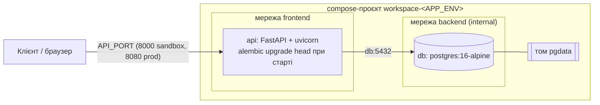

# Лабораторна №5: контейнеризація (Docker, Docker Compose)

## 1. Схема



## 2. Dockerfile (multi-stage)

| Етап | Що робить |
|---|---|
| `builder` (`python:3.12-slim`) | ставить компілятори (`build-essential`, `libpq-dev`), створює venv `/opt/venv`, встановлює `requirements.txt` |
| `runtime` (`python:3.12-slim`) | копіює лише готовий `/opt/venv` і код застосунку; без компіляторів, apt-кешу та pip-кешу |

Інші рішення:

- робоча директорія `/app`;
- процес працює від непривілейованого користувача `app`;
- `PYTHONDONTWRITEBYTECODE`, `PYTHONUNBUFFERED` — без `.pyc` у контейнері та
  з негайним виводом логів;
- `HEALTHCHECK` перевіряє `/health`;
- команда запуску: `alembic upgrade head && exec uvicorn app.main:app
  --workers ${WEB_CONCURRENCY}`. Міграції виконуються автоматично, а `exec`
  робить uvicorn процесом PID 1, щоб він коректно отримував сигнал зупинки;
- залежності розділено: у образ потрапляє лише `requirements.txt`, а
  pytest, ruff та pre-commit лишаються в `requirements-dev.txt`.

`.dockerignore` виключає `.git`, `.venv`, `__pycache__`, логи, **усі
`.env*`** (секрети передаються під час запуску, а не вшиваються в образ),
тести, документацію та файли навантажувального тестування.

## 3. docker-compose.yml

- **db** — офіційний образ `postgres:16-alpine`; дані в іменованому томі
  `pgdata` (зберігаються після `docker compose down`, видаляються лише
  через `down -v`); `healthcheck` через `pg_isready`.
- **api** — збирається з `Dockerfile`; `depends_on: db: condition:
  service_healthy`, тобто API стартує лише коли БД готова приймати
  з'єднання; власний `healthcheck` на `/health/db`.
- **Змінні оточення** — з файлу `.env.${APP_ENV}` (`env_file`). Compose
  читає `APP_ENV`, `API_PORT` з `.env` або з файлу, переданого через
  `--env-file`.
- **Мережі** — `backend` позначена `internal: true`: вона не має виходу
  назовні, і БД доступна лише сервісу `api`. Порт БД на хост не
  публікується. `api` додатково підключений до `frontend` для публікації
  порту API.
- **Середовища** — `name: workspace-${APP_ENV}`: sandbox і production є
  окремими проєктами зі своїми контейнерами, мережами та томами й можуть
  працювати одночасно.

## 4. Hot-reload для розробки

`docker-compose.dev.yml` накладається на основний файл:

- bind mounts `./app`, `./migrations`, `./scripts` → у контейнер;
- `uvicorn --reload --reload-dir /app/app`: сервер перезапускається при
  збереженні файлу, перезбирати образ не потрібно;
- `WATCHFILES_FORCE_POLLING=true`: на Windows/macOS події файлової системи
  через bind mount не доходять у контейнер, тому зміни відстежуються
  опитуванням;
- БД публікується на `127.0.0.1:${POSTGRES_PORT}` для DBeaver/pgAdmin або
  локального запуску uvicorn.

## 5. Перевірка

```bash
copy .env.sandbox.example .env.sandbox     # Linux/macOS: cp
docker compose up --build -d --wait
python scripts/smoke_test.py               # /health/db, реєстрація, вхід, 401
docker compose ps                          # обидва сервіси (healthy)
docker compose logs api                    # "Running upgrade -> 0001" (міграції)
```

Перевірка збереження даних:

```bash
docker compose exec db psql -U sandbox_user -d workspace_sandbox -c "select count(*) from users"
docker compose down          # контейнери видалено, том лишився
docker compose up -d --wait
docker compose exec db psql -U sandbox_user -d workspace_sandbox -c "select count(*) from users"   # те саме число
```

Розмір образу: `docker image ls workspace-reservation-api`.

Ці самі кроки автоматично виконує job **docker** у GitHub Actions
(`.github/workflows/ci.yml`): збірка, запуск sandbox, smoke-тест,
перезапуск із перевіркою кількості користувачів, запуск production як
окремого проєкту з перевіркою вимкненого Swagger, вивід розміру образу.
